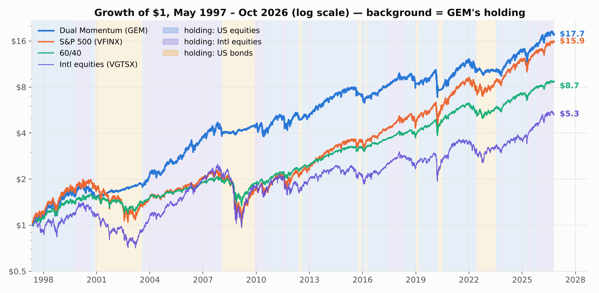

# Dual Momentum (GEM) — backtested

Strategy Lab article #1. Gary Antonacci's Global Equities Momentum: once a month, if US equities' trailing
12-month return beats T-bills, hold whichever of US / international equities has the higher 12-month return;
otherwise hold US aggregate bonds. One asset, all in, no leverage.

**Backtest:** May 1997 – Oct 2026 · VFINX / VGTSX / VBMFX · T-bill hurdle from ^IRX · monthly rebalance ·
next-close execution · 10 bps costs.

| | Dual Momentum | S&P 500 |
| --- | --- | --- |
| CAGR | 10.25% | 9.85% |
| Volatility | 15.0% | 19.2% |
| Sharpe | 0.73 | 0.59 |
| Max drawdown | –33.8% (Feb–Mar 2020) | –55.3% (2007–09) |
| Worst year | –17.3% (2022) | –37.0% (2008) |



## Key findings

- The absolute-momentum (trend) test does the work: on its own it delivers 9.9% CAGR at –34% max drawdown.
  Relative momentum on its own has a *worse* drawdown than the index (–61%).
- Lookbacks from 9 to 15 months are indistinguishable. Walk-forward re-optimising the lookback each year made
  it worse (8.7% vs 9.2% fixed, 2003–2025).
- Pre-publication (1997–2013) it beat the S&P 500 by 5.1 pts/yr; post-publication (2014–2026) it trailed by
  5.4 pts/yr. The edge comes from slow bear markets; it offers no protection in fast crashes (2020, 2025).

## Reproduce

```bash
pip install -r requirements.txt     # installs the shared engine from AlgoStrategyLab/strategylab-core
python run.py                       # fetches Yahoo data (cached in ./data), writes output/*.json (~2 min)
python make_charts.py               # renders output/chart*.png
```

## Files

| File | What it is |
| --- | --- |
| `strategy.py` | The rules, as a `Strategy` subclass |
| `run.py` | Main run, component ablation, lookback sweep, cost sensitivity, in/out-of-sample split, walk-forward, ETF cross-check (SPY/EFA/AGG), episode table |
| `make_charts.py` | The six article charts |
| `output/dual_momentum_main.json` | Full run, schema v1.0 (metrics, yearly table, series, allocations) |
| `output/dual_momentum_summary.json` | Every robustness result in the article |
| `output/dual_momentum_series.csv` | Daily equity, drawdown and holding |

Article: coming soon on Medium. Engine: [strategylab-core](https://github.com/AlgoStrategyLab/strategylab-core).

MIT licensed. Research and education only, not investment advice.
